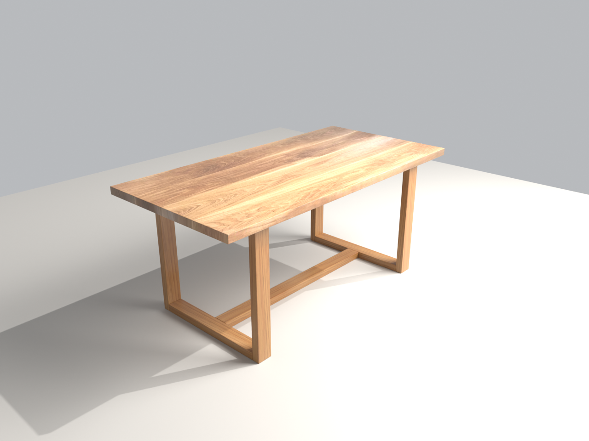

# Oak dining table — Blender model

A 3D model of a solid-oak dining table, built from a hand sketch and photos of the real table, with wood textures taken from those photos.



## Dimensions

| | |
|---|---|
| Overall | 180 × 90 × 79 cm (L × W × H) |
| Tabletop | 45 mm thick |
| Leg frames | two closed rectangular frames, 21 cm in from each end, 120 cm clear between them |
| Frame members, slats | 90 × 45 mm |
| Under the top | two 90 × 45 slats laid flat, running between the frames |
| On the floor | one 90 × 45 rail joining the bottoms of the two frames |

## Files

| Path | What it is |
|---|---|
| `table.blend` | The model (Blender 5.2), textures packed in, with camera, lights and floor set up for Cycles |
| `build_table.py` | Script that generates `table.blend`; all dimensions are constants at the top |
| `textures/tabletop_oak.png` | Tabletop texture, rectified from photo `2.jpg` |
| `textures/leg_oak.png` | Seamless leg grain, from the close-up `5.jpg`, colour-matched to `3.jpg` |
| `preview.png` | Cycles render from the scene camera |
| `drawings/table_drawing.pdf` | Workshop drawing for the carpenter: front, side and top views with mm dimensions and parts list (A3, 1:10) |
| `drawings/table_drawing_ru.pdf` | The same drawing in Russian |
| `drawings/table_drawing*.svg`, `*.png` | Editable vector and screen versions of the drawings |
| `drawings/make_drawing.py` | Generates the drawing SVGs (`en` or `ru`) |
| `1.jpg` | Dimensioned sketch |
| `2.jpg` – `6.jpg` | Reference photos of the real table |

## Rebuild

```sh
blender --background --python build_table.py
```

Regenerate the drawings (then print the SVG to an A3 PDF):

```sh
python3 drawings/make_drawing.py en
python3 drawings/make_drawing.py ru
```

Render a preview:

```sh
blender --background table.blend --render-output //preview_ --render-frame 1
```
